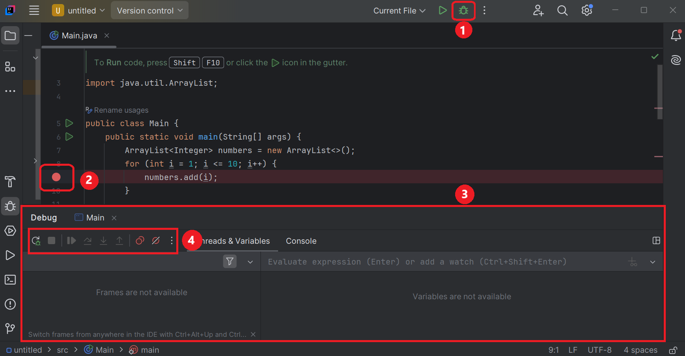

<h1>
  <span class="headline">Java Debugging</span>
  <span class="subhead">Breakpoints</span>
</h1>

**Learning objective:** By the end of this lesson, you'll be able to debug a java program by pausing your program execution using breakpoints, and then observing variables and runtime behaviour using step-by-step debugging.

## Breakpoints

A breakpoint is a marker that we set in our code to pause the program's execution at a specific line. Breakpoints help us to:

1. Examine the state of the program at a particular point.
2. Verify the flow of execution.
3. Check the values of variables.

## Demo: Debugging using breakpoints in IntelliJ IDEA Community Edition IDE

Here are the IntelliJ IDEA Community Edition IDE's debugging UI elements.


1. Debug icon
2. Breakpoint (red dot)
3. Debug panel
4. Debug execution navigation options

These are the sequence of steps you need to follow to debug using breakpoints.

### Step 1: Setting a breakpoint
1. Open your Java project in IntelliJ.
2. Locate the line of code where you want to pause execution.
3. Click in the gutter area (the left margin next to the line numbers). A red dot will appear, indicating a breakpoint is set.

### Step 2: Starting the debugger
4. Click the Debug icon (a green bug icon) in the top-right corner.
5. IntelliJ will compile and run your program in debug mode, stopping at the first active breakpoint.

### Step 3: Navigating the debugging controls
Once the program pauses at a breakpoint, use the navigation buttons in the Debug panel (at the bottom of the IDE) to control execution:

- **Resume Program**: Continues execution until the next breakpoint.
- **Step Over**: Executes the current line and moves to the next line in the same method.
- **Step Into**: Steps into the method call to debug its code.
- **Step Out**: Steps out of the current method and returns to the caller.
- **Stop**: Stops the debugging session.

## Debugging features in IntelliJ IDEA Community Edition IDE

### Watching variables
- We can hover over a variable to see its current value.
- Alternatively, we can check the Variables tab in the Debug tool window to view all active variables and their values.

### Modifying variables
- We can right-click a variable in the Variables tab and select 'Set Value' to modify its value during debugging.

### Evaluating expressions
- We can Highlight any expression or variable, then right-click and choose Evaluate Expression.We can use this feature to test expressions or perform calculations on the fly.

### Adding conditional breakpoints
- We can right-click a breakpoint to add a condition (for example, x > 5) to make the breakpoint active only when the condition is true.

## Independent practice
(15 minutes)

Use this sample program to experiment with the breakpoint and debugging related tasks listed below. Feel free to try some of your own experiments too

``` java
import java.util.ArrayList;

public class DebuggingExample {
    public static void main(String[] args) {
        ArrayList<Integer> numbers = new ArrayList<>();
        for (int i = 1; i <= 10; i++) {
            numbers.add(i);
        }

        int sum = calculateSum(numbers);
        System.out.println("The sum of numbers is: " + sum);
    }

    public static int calculateSum(ArrayList<Integer> numbers) {
        int sum = 0;
        for (int num : numbers) {
            sum += num;
        }
        return sum;
    }
}
```

### Task 1: Set breakpoints
1. Place a breakpoint on the `numbers.add(i)` line inside the `for` loop.
2. Place another breakpoint on the `sum += num` line in the `calculateSum` method.

### Task 2: Start debugging
1. Click the Debug icon.

### Task 3: Observe the execution flow
1. The program will pause at the first breakpoint `(numbers.add(i))`.
2. Hover over `numbers` in the **Debug** panel to see the current state of the list.

### Task 4: Step through the code
1. Click the **Step Over** icon to see how the `for` loop adds elements to the list.
2. When execution reaches the `calculateSum` method, click the **Step Into** icon to debug its logic.

### Task 5: Evaluate variables
1. At the `sum += num` line, hover over `sum` and `num` in the Debug panel to see their values.
2. Use the Evaluate Expression feature (Alt+F8) to test sum + num.

### Task 6: Resume and complete execution
1. Click the Resume Program icon to allow the program to complete execution.

